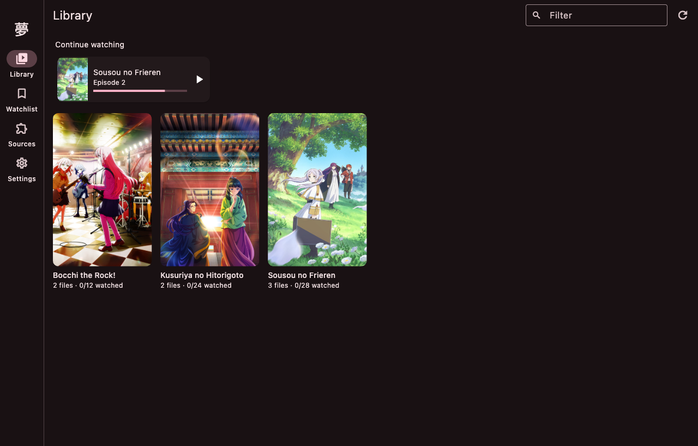
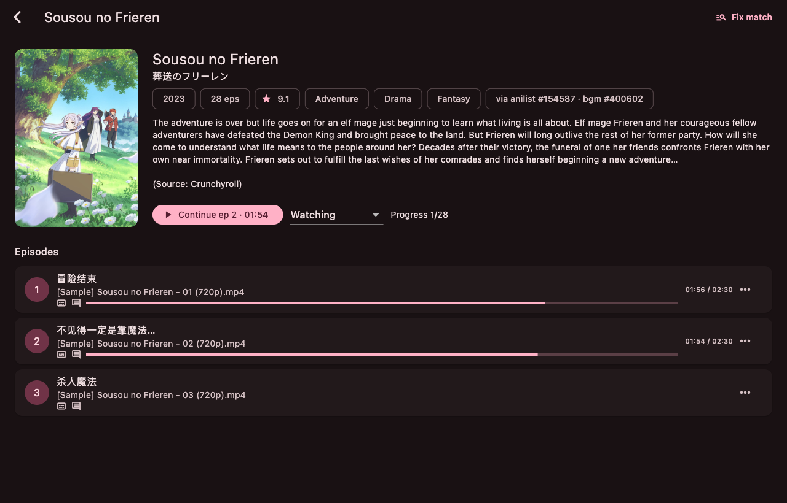
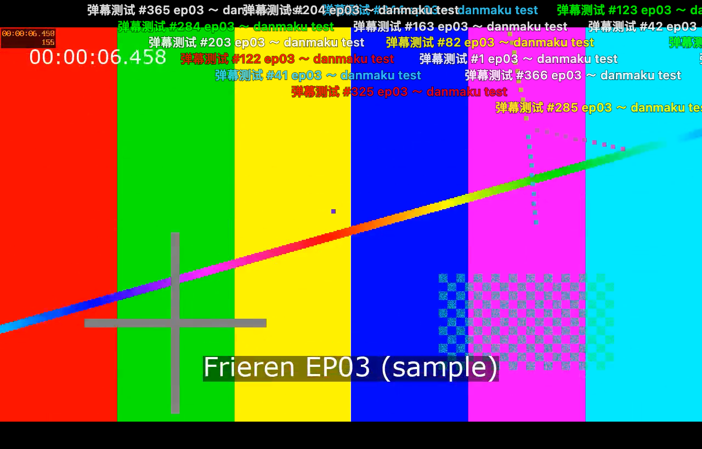

# Yume 夢

A personal, Kazumi-inspired anime player for macOS (Flutter, cross-platform-ready).
Own code. [Kazumi](https://github.com/Predidit/Kazumi) served only as inspiration.



| Show page | Player with danmaku |
|---|---|
|  |  |

## Features (v0.1)

| | Status |
|---|---|
| **Local library**: scans folders (default `/Volumes/Seagate_ddx/07 Anime`), parses release names (`[Group] Title - 03`, `Title.S01E03`, `第03话`, `Episode 03` in a show folder…), groups into shows/seasons | ✅ |
| **Auto metadata**: AniList (cover, synopsis, score, genres, episode count) + Bangumi (Chinese episode titles, ids); manual "Fix match" dialog | ✅ no keys needed |
| **Player**: media_kit / libmpv, ASS/SRT subtitles via libass (embedded + sidecar files auto-loaded), audio/subtitle track menus, speed, fullscreen, keyboard shortcuts, auto next episode | ✅ |
| **Resume**: position saved every 5 s per file; "Continue watching" row; resumes with a "Start over" option | ✅ |
| **Danmaku**: own renderer (lane allocation, scroll/top/bottom, colours, seek-safe, works in fullscreen). Sources: Bilibili-format `<video>.xml` sidecar, or DanDanPlay (hash + title match) | ✅ local XML · ⏳ DanDanPlay needs AppId/Secret |
| **Watchlist**: local statuses/progress, auto-advanced when an episode is watched (≥85 %) | ✅ |
| **Sync**: push progress to AniList (`SaveMediaListEntry`) and Bangumi (collection + episodes) | ⏳ code done, needs your tokens (see below) |
| **Source plug-ins**: `MediaSource` interface + registry, Local library and Direct URL sources. No scrapers for unlicensed sites | ✅ see [docs/PLUGINS.md](docs/PLUGINS.md) |

## Run

```bash
flutter run -d macos
```

Requires Flutter 3.47+ and Xcode. The app is unsandboxed (see
`macos/Runner/*.entitlements`) so it can read external volumes.

Data (settings, library index, progress, watchlist; small JSON files) lives in
`~/Library/Application Support/com.ddx.yume/`. Covers and danmaku are cached in
`<library>/.yume/cache` on the external disk, so the Mac's drive stays free.

### Sample library

```bash
tool/make_sample_library.sh
```

Writes to `/Volumes/Seagate_ddx/07 Anime/_Yume sample`: synthetic test-pattern
clips (no real content) for three shows, with `.ass` subtitles and danmaku XML,
to exercise scanning, matching, subtitles, resume and danmaku. Delete the
folder when you no longer need it.

### Keyboard (player)

`Space`/`K` play-pause · `←/→` ±5 s · `J/L` ±10 s · `S` skip 85 s (OP) ·
`↑/↓` volume · `D` danmaku on/off · `F` fullscreen · `N` next episode · `Esc` exit fullscreen

## Accounts and keys (optional, all entered in Settings)

| What | Where to get it | Unlocks |
|---|---|---|
| DanDanPlay AppId + AppSecret | apply at https://doc.dandanplay.com/open/ | online danmaku for any episode |
| AniList Client ID | https://anilist.co/settings/developer → create client, redirect URL `https://anilist.co/api/v2/oauth/pin` | "Authorize in browser" → paste token → progress sync |
| Bangumi access token | https://next.bgm.tv/demo/access-token | progress sync to bgm.tv |

Secrets are stored only in the local settings JSON, never in the repo.

## Layout

```
lib/
  main.dart, app_services.dart     app entry + service wiring
  models/                          Show, EpisodeFile, PlaybackProgress, WatchEntry
  util/filename_parser.dart        release-name parser
  services/                        scanner, library, metadata (AniList/Bangumi),
                                   progress, watchlist, trackers, cover cache
  danmaku/                         models + parsers, DanDanPlay client, overlay renderer
  sources/                         MediaSource plug-in API + built-in sources
  ui/screens/                      library, show detail, player, watchlist, sources, settings
  debug/debug_hooks.dart           debug-build-only VM service hooks for automated checks
test/                              parser, grouping and danmaku parsing tests
tool/make_sample_library.sh        synthetic sample library generator
```

## Next steps

- DanDanPlay: verify request signing against a real AppId/Secret; add a manual episode-match picker.
- AniList sync: OAuth redirect via a localhost listener instead of copy-paste PIN.
- Pull remote list status on startup (two-way sync), not just push.
- Danmaku: keep top-fixed comments out of the first scroll lane; density limit; block-word filter.
- Per-source config UI; Jellyfin/Plex example source.
- Windows/Linux runners are generated but untested.
